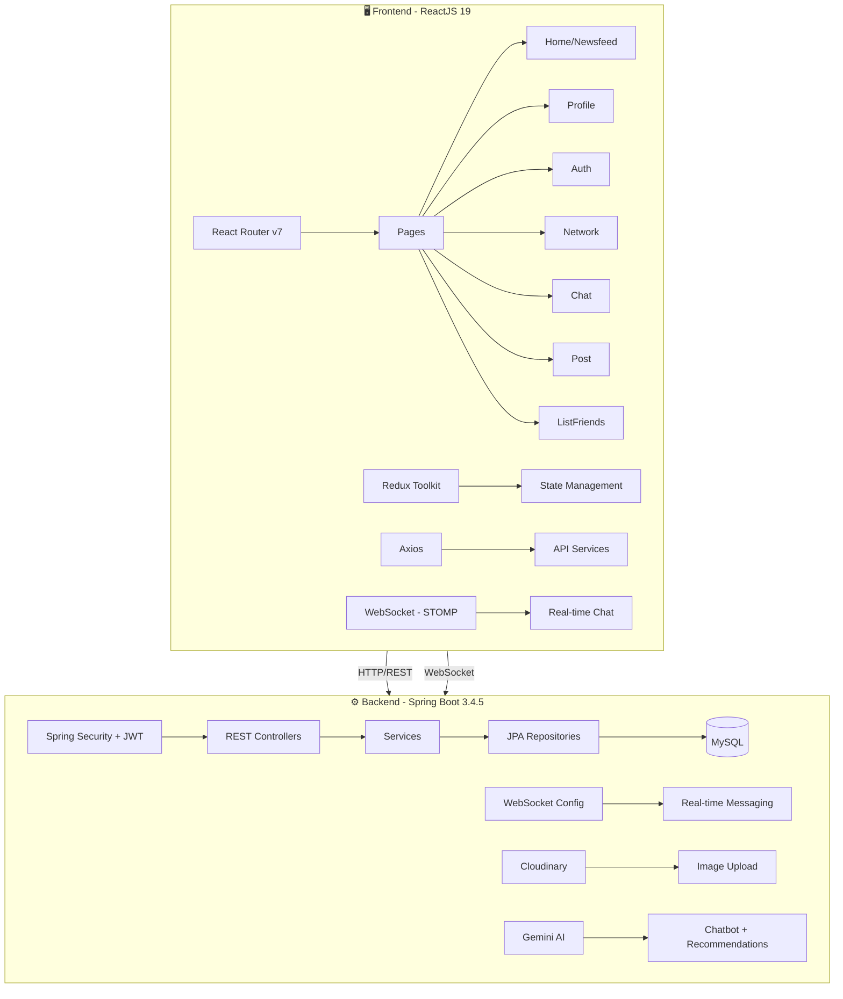
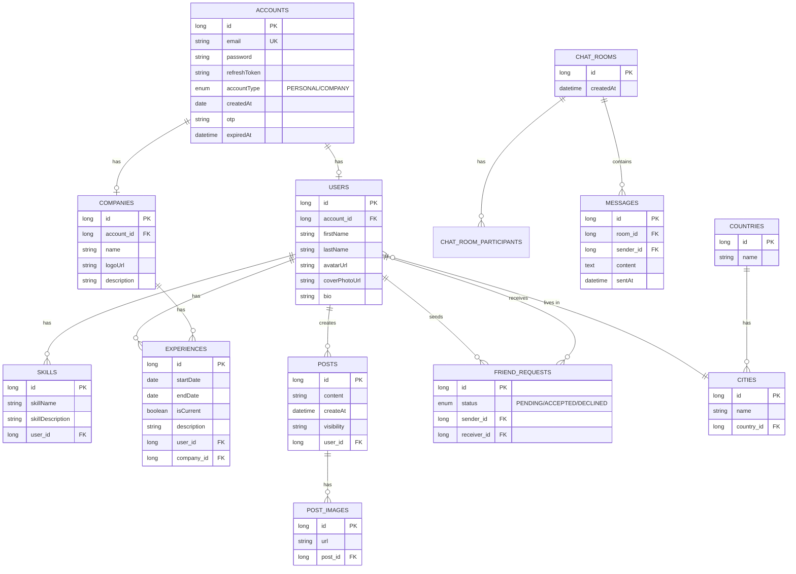
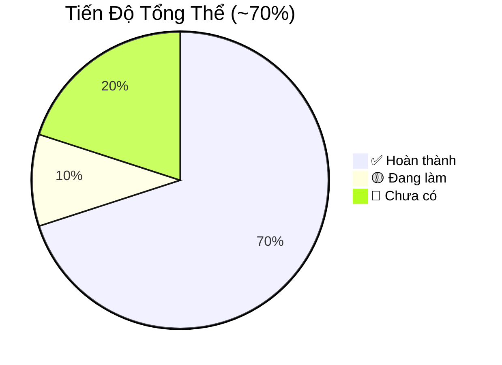

# 📋 LinkedIn Clone - Tổng Quan Dự Án

Nhấn Ctrl + Shift + V để xem hình ảnh

> **Ngày review:** 09/04/2026  
> **Tech Stack:** Spring Boot 3.4.5 (Java 21) + React 19 (CRA)  
> **Database:** MySQL  
> **Trạng thái tổng thể:** 🟡 Đang phát triển (~70% core features)

---

## 🏗️ Kiến Trúc Tổng Quan



---

## 📊 Database Schema (Entity Relationship)



---

## ✅ Tính Năng Đã Hoàn Thành

### 1. 🔐 Authentication & Authorization

| Tính năng                    | Frontend                 | Backend                          | Trạng thái |
| ---------------------------- | ------------------------ | -------------------------------- | ---------- |
| Đăng ký (Email/Password)     | ✅ Register page         | ✅ `POST /register`              | ✅ Done    |
| Đăng nhập (Email/Password)   | ✅ Login page            | ✅ `POST /login`                 | ✅ Done    |
| Đăng nhập Google OAuth       | ✅ `@react-oauth/google` | ✅ `POST /auth/oauth/google`     | ✅ Done    |
| Đăng xuất                    | ✅                       | ✅ `POST /logout`                | ✅ Done    |
| JWT (Access + Refresh Token) | ✅ Axios interceptor     | ✅ Spring Security + HS256       | ✅ Done    |
| Quên mật khẩu (Email OTP)    | ✅ 3 steps UI            | ✅ `EmailService` + `OtpService` | ✅ Done    |
| Đổi mật khẩu                 | ✅ NewPasswordForm       | ✅ `POST /change-password`       | ✅ Done    |

### 2. 👤 User Profile

| Tính năng                 | Frontend                         | Backend                            | Trạng thái |
| ------------------------- | -------------------------------- | ---------------------------------- | ---------- |
| Xem profile cá nhân       | ✅ ProfileHeader, ProfileSidebar | ✅ `GET /api/me`                   | ✅ Done    |
| Xem profile người khác    | ✅ `/profile/:email`             | ✅ `GET /api/user-by-email`        | ✅ Done    |
| Chỉnh sửa profile         | ✅ EditProfileModal              | ✅ `PATCH /api/users/{id}/profile` | ✅ Done    |
| Avatar & Cover Photo      | ✅ Hiển thị                      | ✅ Cloudinary upload               | ✅ Done    |
| Skills section            | ✅ ProfileSkill component        | ✅ Entity + cascade                | ✅ Done    |
| Experience section        | ✅ ProfileExperience             | ✅ Entity liên kết Company         | ✅ Done    |
| Education section         | ✅ ProfileEducation              | ❓ Chưa rõ entity riêng            | 🟡 UI có   |
| Activity/Posts on profile | ✅ ProfileActivity + PostCard    | ✅ `GET /api/posts?email=`         | ✅ Done    |
| Location (Country/City)   | ✅ API services                  | ✅ Country + City entities         | ✅ Done    |

### 3. 📝 Posts / Newsfeed

| Tính năng                   | Frontend                             | Backend                                 | Trạng thái      |
| --------------------------- | ------------------------------------ | --------------------------------------- | --------------- |
| Tạo bài viết (text + ảnh)   | ✅ CreatePostModal                   | ✅ `POST /api/posts`                    | ✅ Done         |
| Newsfeed (infinite scroll)  | ✅ `react-infinite-scroll-component` | ✅ Cursor pagination (`lastId`)         | ✅ Done         |
| Upload nhiều ảnh            | ✅ FormData multipart                | ✅ Cloudinary + `POST /api/images/post` | ✅ Done         |
| Xem bài viết theo user      | ✅ PostList component                | ✅ `GET /api/posts?email=`              | ✅ Done         |
| Chỉnh sửa bài viết          | ✅ EditPostModal                     | ✅ `PATCH /api/posts/{id}`              | ✅ Done         |
| Xóa bài viết                | ✅                                   | ✅ `DELETE /api/posts/{id}`             | ✅ Done         |
| SortBar (sắp xếp)           | ✅ UI component                      | ❓                                      | 🟡 UI only      |
| Visibility (public/private) | ❓                                   | ✅ Entity field                         | 🟡 Backend only |

### 4. 🤝 Network / Friends

| Tính năng                 | Frontend                     | Backend                                         | Trạng thái |
| ------------------------- | ---------------------------- | ----------------------------------------------- | ---------- |
| Gửi lời mời kết bạn       | ✅ SuggestedCard             | ✅ `POST /api/friend-requests`                  | ✅ Done    |
| Xem lời mời đã nhận       | ✅ ConnectionRequests        | ✅ `GET /api/friend-requests/receiver/{status}` | ✅ Done    |
| Xem lời mời đã gửi        | ✅                           | ✅ `GET /api/friend-requests/sender/{status}`   | ✅ Done    |
| Chấp nhận/Từ chối lời mời | ✅                           | ✅ Accept/Decline endpoints                     | ✅ Done    |
| Xóa bạn bè                | ✅                           | ✅ `DELETE /api/friend-requests/{id}`           | ✅ Done    |
| Gợi ý kết bạn             | ✅ SuggestedList             | ✅ `GET /api/users` (tất cả users)              | ✅ Done    |
| Danh sách bạn bè          | ✅ ListFriends page          | ✅ Filter by ACCEPTED                           | ✅ Done    |
| Network Overview          | ✅ NetworkOverview component | ✅                                              | ✅ Done    |

### 5. 💬 Real-time Chat

| Tính năng                         | Frontend               | Backend                                   | Trạng thái |
| --------------------------------- | ---------------------- | ----------------------------------------- | ---------- |
| Tạo phòng chat                    | ✅                     | ✅ `POST /api/chat/create-room`           | ✅ Done    |
| Gửi/nhận tin nhắn real-time       | ✅ STOMP/WebSocket     | ✅ WebSocket + `MessageController`        | ✅ Done    |
| Lịch sử tin nhắn                  | ✅ ChatWindow          | ✅ `GET /api/chat/get-msg-by-roomid/{id}` | ✅ Done    |
| Danh sách phòng chat              | ✅ Chat Sidebar        | ✅ `GET /api/chat/get-list-chat-room`     | ✅ Done    |
| Chat 1-1                          | ✅                     | ✅ ChatRoomParticipant                    | ✅ Done    |
| Info panel (thông tin người chat) | ✅ Info component      | ✅                                        | ✅ Done    |
| Custom hook `useChat`             | ✅ WebSocket lifecycle | -                                         | ✅ Done    |

### 6. 🤖 AI Features

| Tính năng                | Frontend                                                                                                                                                                         | Backend                                           | Trạng thái |
| ------------------------ | -------------------------------------------------------------------------------------------------------------------------------------------------------------------------------- | ------------------------------------------------- | ---------- |
| Chatbot (Gemini AI)      | ✅ ChatbotWidget + ChatIconButton                                                                                                                                                | ✅ `POST /chat` → Gemini API                      | ✅ Done    |
| Gợi ý kết bạn bằng AI    | ✅ [aiSuggestionsUser.service.js](file:///c:/Users/ADMIN/OneDrive%20-%20University%20of%20Technology%20and%20Education/ReactJS/social/src/services/aiSuggestionsUser.service.js) | ✅ `GET /api/recommendations/custom-ai-suggested` | ✅ Done    |
| AI Recommendations (raw) | -                                                                                                                                                                                | ✅ `GET /api/recommendations/ai-suggested`        | ✅ Backend |

---

## 🔴 Tính Năng Chưa Có / Cần Phát Triển

### Thiếu so với LinkedIn thật:

| Tính năng                  | Mức độ ưu tiên | Ghi chú                         |
| -------------------------- | -------------- | ------------------------------- |
| 👍 Like/React bài viết     | 🔴 Cao         | Chưa có entity Like/Reaction    |
| 💬 Comment bài viết        | 🔴 Cao         | Chưa có entity Comment          |
| 🔔 Notifications           | 🔴 Cao         | Chưa có hệ thống thông báo      |
| 🔍 Search (users, posts)   | 🔴 Cao         | Chưa có tìm kiếm                |
| 📋 Jobs / Việc làm         | 🟡 Trung bình  | Core feature LinkedIn           |
| 🏢 Company Page            | 🟡 Trung bình  | Entity có nhưng chưa có UI      |
| 📨 Connection message      | 🟡 Trung bình  | Gửi lời nhắn kèm lời mời        |
| 🔗 Share bài viết          | 🟢 Thấp        |                                 |
| 📊 Analytics profile views | 🟢 Thấp        |                                 |
| 🎓 Education entity riêng  | 🟡 Trung bình  | UI có nhưng backend chưa rõ     |
| 📱 Responsive design       | 🟡 Trung bình  | Cần kiểm tra                    |
| 🛡️ Private routes          | 🟡 Trung bình  | `privateRoutes` đang rỗng       |
| 🖼️ Group Chat              | 🟢 Thấp        | Backend hỗ trợ nhưng UI chỉ 1-1 |

---

## 📁 Cấu Trúc Project

### Frontend (`social/`)

```
src/
├── App.js                    # Router + Chatbot widget
├── config/
│   └── routes.js             # 11 routes defined
├── pages/
│   ├── Auth/                 # Login, Register, ForgotPassword (3 steps)
│   ├── Home/                 # Newsfeed + Sidebar + CreatePost + PostList
│   ├── Profile/              # Header, Skills, Experience, Education, Activity
│   ├── Post/                 # PostList + EditPost + Sidebar
│   ├── Network/              # ConnectionRequests, SuggestedList, Overview
│   ├── Chat/                 # Sidebar + ChatWindow + Info
│   └── ListFriends/          # Danh sách bạn bè
├── components/
│   ├── GlobalStyles/         # CSS global
│   └── chatbot/              # ChatIconButton + ChatbotWidget
├── services/                 # 10 API service files
│   ├── auth.service.js       # login, register, logout, Google
│   ├── post.service.js       # CRUD posts + image upload
│   ├── chat.service.js       # chat rooms + messages
│   ├── network.service.js    # friend requests
│   ├── user.service.js       # profile CRUD
│   ├── newsfeed.service.js   # infinite scroll newsfeed
│   ├── chatbot.service.js    # Gemini chatbot
│   ├── aiSuggestionsUser.service.js  # AI friend suggestions
│   ├── sendOtp.service.js    # OTP forgot password
│   └── location.service.js   # Countries + Cities
├── hooks/
│   ├── useChat.js            # WebSocket chat hook
│   └── useFacebookSDK.js     # Facebook SDK (chưa dùng?)
├── redux/
│   ├── store.js              # Redux store + persist
│   └── slices/               # Redux slices
├── layouts/
│   ├── DefaultLayout/        # Header + content
│   └── HeaderOnly/           # Chỉ header
└── routes/
    └── index.js              # Route registry
```

### Backend (`social_be/`)

```
src/main/java/com/hdlh/social_be/
├── controller/               # 15 REST controllers
│   ├── AuthController.java         # Login/Register/Logout/Refresh/Google OAuth
│   ├── UserController.java         # Profile CRUD
│   ├── PostController.java         # Post CRUD + Newsfeed
│   ├── FriendRequestController.java # Friend system
│   ├── ChatRoomController.java     # Chat rooms
│   ├── MessageController.java      # Chat messages
│   ├── WebSocketController.java    # WebSocket endpoints
│   ├── ChatbotController.java      # Gemini AI chatbot
│   ├── AiRecommendationController.java  # AI suggestions
│   ├── ImageUploadController.java  # Cloudinary upload
│   ├── OtpController.java         # OTP endpoints
│   ├── CityController.java        # Cities
│   ├── CountryController.java     # Countries
│   ├── AccountController.java     # Account management
│   └── HelloController.java       # Health check
├── domain/                   # 14 JPA entities
│   ├── Account.java, User.java, Company.java
│   ├── Post.java, PostImage.java
│   ├── Skill.java, Experience.java
│   ├── FriendRequest.java
│   ├── ChatRoom.java, ChatRoomParticipant.java, Message.java
│   ├── City.java, Country.java
│   ├── dto/                  # 15+ DTOs
│   └── enums/                # AccountType, Status
├── service/                  # 15 service classes
├── repository/               # 8 JPA repositories
├── config/                   # Security, CORS, WebSocket
│   ├── SecurityConfiguration.java  # JWT + OAuth2
│   ├── CorsConfig.java
│   └── WebSocketConfig.java
├── auth/                     # Google Auth Provider
├── adapter/                  # Cloudinary adapter
├── mapper/                   # Object mappers
└── util/                     # Security util + Error handling
```

---

## 🔧 API Endpoints Summary

### Public (No Auth Required)

| Method | Endpoint             | Mô tả          |
| ------ | -------------------- | -------------- |
| POST   | `/register`          | Đăng ký        |
| POST   | `/login`             | Đăng nhập      |
| POST   | `/logout`            | Đăng xuất      |
| POST   | `/auth/oauth/google` | Google OAuth   |
| GET    | `/check-email`       | Kiểm tra email |
| GET    | `/send-otp`          | Gửi OTP        |
| GET    | `/verify-otp`        | Xác minh OTP   |
| POST   | `/change-password`   | Đổi mật khẩu   |
| POST   | `/chat`              | Chatbot        |

### Protected (JWT Required - `/api/**`)

| Method | Endpoint                                   | Mô tả                        |
| ------ | ------------------------------------------ | ---------------------------- |
| GET    | `/api/me`                                  | Profile hiện tại             |
| GET    | `/api/user-by-email`                       | Profile theo email           |
| PATCH  | `/api/users/{id}/profile`                  | Cập nhật profile             |
| GET    | `/api/users`                               | Tất cả users                 |
| GET    | `/api/posts/newsfeed`                      | Newsfeed (cursor pagination) |
| GET    | `/api/posts?email=`                        | Posts theo user              |
| POST   | `/api/posts`                               | Tạo post                     |
| PATCH  | `/api/posts/{id}`                          | Sửa post                     |
| DELETE | `/api/posts/{id}`                          | Xóa post                     |
| POST   | `/api/images/post`                         | Upload ảnh                   |
| POST   | `/api/friend-requests`                     | Gửi lời mời                  |
| GET    | `/api/friend-requests/receiver/{status}`   | Lời mời nhận                 |
| GET    | `/api/friend-requests/sender/{status}`     | Lời mời gửi                  |
| POST   | `/api/friend-requests/accept/{id}`         | Chấp nhận                    |
| POST   | `/api/friend-requests/decline/{id}`        | Từ chối                      |
| DELETE | `/api/friend-requests/{id}`                | Xóa bạn                      |
| POST   | `/api/chat/create-room`                    | Tạo phòng chat               |
| GET    | `/api/chat/get-chat-room`                  | Lấy phòng chat               |
| GET    | `/api/chat/get-list-chat-room`             | DS phòng chat                |
| GET    | `/api/chat/get-msg-by-roomid/{id}`         | Lịch sử chat                 |
| GET    | `/api/recommendations/ai-suggested`        | AI gợi ý (raw)               |
| GET    | `/api/recommendations/custom-ai-suggested` | AI gợi ý (custom)            |
| GET    | `/api/countries`                           | DS quốc gia                  |
| GET    | `/api/cities/by-country/{id}`              | DS thành phố                 |

---

## 📈 Đánh Giá Tiến Độ



| Module            | Tiến độ | Chi tiết                                        |
| ----------------- | ------- | ----------------------------------------------- |
| 🔐 Authentication | 95%     | ✅ Rất đầy đủ (email, Google, OTP, JWT refresh) |
| 👤 Profile        | 85%     | ✅ Tốt, thiếu Education entity rõ ràng          |
| 📝 Posts          | 75%     | ✅ CRUD ok, thiếu Like/Comment                  |
| 🤝 Network        | 80%     | ✅ Friend system tốt, thiếu Search              |
| 💬 Chat           | 85%     | ✅ Real-time WebSocket hoạt động tốt            |
| 🤖 AI             | 70%     | ✅ Chatbot + Recommendations có                 |
| 🔔 Notifications  | 0%      | ❌ Chưa có                                      |
| 🔍 Search         | 0%      | ❌ Chưa có                                      |
| 📋 Jobs           | 0%      | ❌ Chưa có                                      |
| 🏢 Company Pages  | 20%     | Entity có, chưa có UI                           |

---

## 🎯 Đề Xuất Ưu Tiên Tiếp Theo

> [!IMPORTANT]
> Các tính năng nên làm tiếp theo, sắp xếp theo mức ưu tiên:

### Phase 1 - Core Social Features 🔴

1. **Like/React system** - Entity `PostLike` + API + UI (nút like trên mỗi post)
2. **Comment system** - Entity `Comment` + nested comments + API + UI
3. **Notifications** - Entity `Notification` + WebSocket push + Bell icon

### Phase 2 - Usability 🟡

4. **Search** - Full-text search users + posts
5. **Private Routes** - Chuyển routes cần auth sang `privateRoutes`
6. **Company Pages** - UI cho entity Company đã có
7. **Responsive Design** - Mobile-first CSS

### Phase 3 - Advanced 🟢

8. **Jobs/Recruitment** - Core LinkedIn feature
9. **Share posts** - Reshare mechanism
10. **Group Chat** - Backend đã hỗ trợ multi-participant

---

## 🛠️ Tech Dependencies

### Frontend

| Package                         | Version | Mục đích            |
| ------------------------------- | ------- | ------------------- |
| react                           | 19.1.0  | UI Framework        |
| react-router-dom                | 7.5.0   | Routing             |
| @reduxjs/toolkit                | 2.8.2   | State management    |
| redux-persist                   | 6.0.0   | Persist state       |
| axios                           | 1.10.0  | HTTP client         |
| @stomp/stompjs                  | 7.1.1   | WebSocket           |
| sockjs-client                   | 1.6.1   | WebSocket fallback  |
| @react-oauth/google             | 0.12.2  | Google Login        |
| jwt-decode                      | 4.0.0   | JWT decode          |
| react-modal                     | 3.16.3  | Modals              |
| react-infinite-scroll-component | 6.1.0   | Infinite scroll     |
| emoji-picker-react              | 4.13.3  | Emoji picker        |
| lucide-react + react-icons      | latest  | Icons               |
| dayjs                           | 1.11.18 | Date formatting     |
| sass                            | 1.86.3  | SCSS modules        |
| classnames                      | 2.5.1   | CSS class utilities |

### Backend

| Dependency                               | Mục đích                |
| ---------------------------------------- | ----------------------- |
| Spring Boot 3.4.5                        | Framework               |
| Spring Security + OAuth2 Resource Server | Auth + JWT              |
| Spring Data JPA                          | ORM                     |
| Spring WebSocket                         | Real-time chat          |
| Spring WebFlux                           | Async HTTP (Gemini API) |
| Spring Mail                              | Send OTP emails         |
| MySQL Connector 9.3.0                    | Database                |
| Lombok 1.18.30                           | Boilerplate reduction   |
| Cloudinary Core 2.3.0                    | Image CDN               |
| Apache HttpClient                        | External API calls      |
| Spring Actuator                          | Health monitoring       |

---

> [!NOTE]
> Dự án đã có nền tảng rất tốt với hầu hết core features của một mạng xã hội chuyên nghiệp. Hệ thống auth rất hoàn chỉnh (JWT refresh + Google OAuth + OTP). Real-time chat hoạt động. AI features (chatbot + friend recommendations) là điểm cộng lớn. Cần bổ sung Like/Comment/Notification để hoàn thiện trải nghiệm social.
